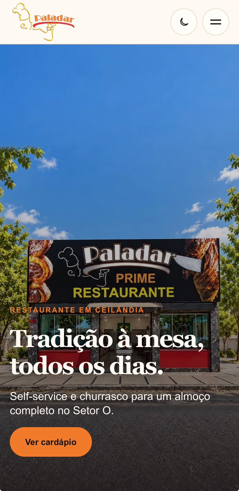

# Paladar Web

Site institucional e comercial do Restaurante Paladar, em Ceilândia (DF). A aplicação apresenta o restaurante, o cardápio de bebidas e sobremesas, as marmitas, a história da marca, o Paladar Buffet e os canais oficiais de contato.

**Site oficial:** [churrascariapaladar.com.br](https://churrascariapaladar.com.br)

## Screenshots

### Desktop


### Mobile



## Funcionalidades principais

- Home responsiva com Hero cinematográfica controlada pelo scroll;
- navegação global adaptada para desktop e mobile;
- temas claro e escuro com preferência persistida no navegador;
- páginas de Cardápio, Marmitas, Sobre, Buffet e Contato;
- cardápio e informações institucionais centralizados em dados TypeScript;
- pedidos de marmitas por WhatsApp com mensagens específicas por opção;
- integração com Google Maps, Instagram, e-mail e site do Paladar Buffet;
- página 404 e estado global de carregamento personalizados;
- suporte a `prefers-reduced-motion`, foco visível e navegação por teclado;
- metadata por rota, canonical, Open Graph, Twitter Cards e JSON-LD do tipo `Restaurant`;
- `robots.txt`, `sitemap.xml`, manifest, ícones e redirecionamento permanente de `www` para o domínio principal.

## Tecnologias utilizadas

| Tecnologia | Uso |
| --- | --- |
| Next.js 16.3.7 | Framework, App Router, renderização e metadata |
| React 19.2.8 | Interface e componentes interativos |
| TypeScript 5 | Tipagem da aplicação e dos dados estáticos |
| CSS Modules | Estilos específicos de páginas e componentes |
| CSS global | Design tokens, temas, reset e estilos base |
| ESLint 9 | Análise estática com regras do Next.js |
| Node.js Test Runner | Testes unitários dos dados e helpers |

O projeto utiliza npm e não depende de backend, banco de dados, CMS ou bibliotecas de interface externas.

## Estrutura do projeto

```text
paladar-web/
├── assets/                 # fontes e referências preservadas de mídia
├── docs/                   # documentação técnica e da biblioteca de mídia
├── public/                 # imagens, ícones e vídeos servidos publicamente
├── src/
│   ├── app/                # rotas, layout, metadata e estilos do App Router
│   ├── components/         # Header, Footer, Hero e ThemeToggle
│   ├── data/               # conteúdo estático e configurações tipadas
│   └── lib/                # helpers de tema e SEO
├── next.config.ts          # configuração e canonicalização de host
├── package.json            # scripts e dependências
└── tsconfig.json           # configuração TypeScript e alias @/*
```

Detalhes de arquitetura, implantação e manutenção estão em [docs/project-guide.md](docs/project-guide.md). A organização dos assets está documentada em [docs/media-assets.md](docs/media-assets.md).

## Desenvolvimento local

Pré-requisitos: Node.js compatível com Next.js 16 e npm.

```bash
npm ci
npm run dev
```

A aplicação fica disponível em [http://localhost:3000](http://localhost:3000).

Para validar o servidor de produção localmente:

```bash
npm run build
npm run start
```

## Testes e validações

O projeto mantém testes com o runner nativo do Node.js. Como não há um script `test` no `package.json`, a suíte completa é executada diretamente:

```bash
node --experimental-strip-types --test src/app/theme-contrast.test.mjs src/components/Hero/hero-progress.test.mjs src/data/menu.test.mjs src/data/restaurant.test.mjs src/data/site-links.test.mjs src/lib/seo.test.mjs src/lib/theme.test.mjs
```

Validações complementares:

```bash
npm run lint
npm run build
git diff --check
```

## Implantação e hospedagem

O site é hospedado na Hostinger como uma aplicação Next.js executada em Node.js. A entrega é manual, por um arquivo ZIP gerado do `HEAD` validado da branch `main`, sem incluir `node_modules`, `.next`, arquivos de ambiente ou conteúdo não rastreado.

O procedimento completo e o checklist pós-implantação estão em [docs/project-guide.md](docs/project-guide.md#implantação-manual-na-hostinger).

## Autor

**André Vinícius Branches Cunha**

GitHub: [@branchescunha](https://github.com/branchescunha)
